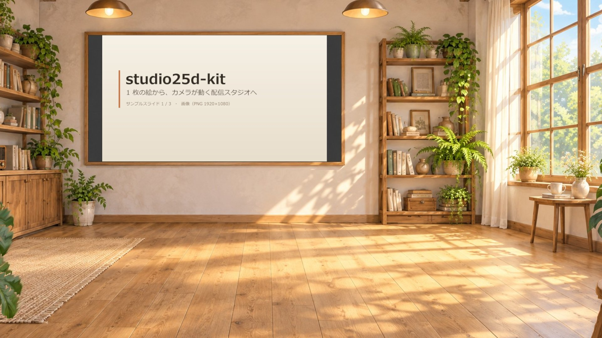
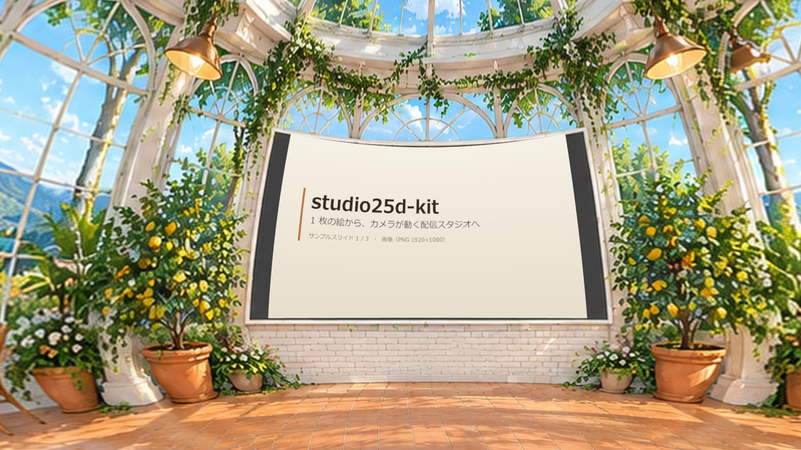
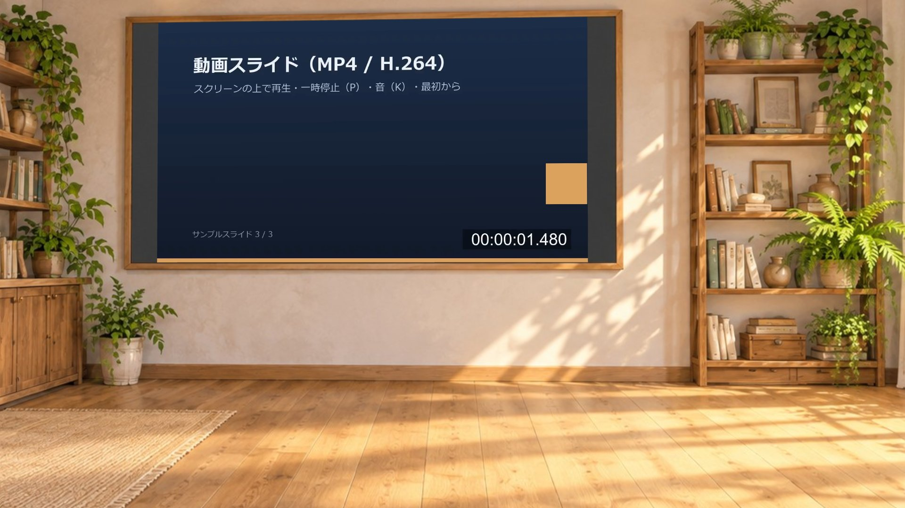

# studio25d-kit

**1 枚のイラストを「カメラが動く配信スタジオ」にするキット。** ブラウザだけで動く 2.5D スタジオと 360° の部屋。
部屋の中のスクリーンに自分のスライド（画像・PDF・動画）を映して、LT や配信にそのまま使えます。OBS のブラウザソースで取り込めます。



| 360° の部屋（見本：温室カフェ） | スクリーンで動画スライドを再生中 |
|---|---|
|  |  |

## しくみ（3 行で）

- **2.5D の部屋**：イラスト 1 枚＋その深度画像（AI で推定）から、画素ごとに奥行きを持つメッシュを作る。カメラを少し動かすと手前と奥がずれて（視差）立体に見える。カメラは「絵の外が絶対に映らない範囲」へ自動で押し戻される（幾何クランプ）。
- **360° の部屋**：正距円筒パノラマ（2:1）を、下半分が床になる球（three.js `GroundedSkybox`）に貼る。カメラは部屋の中をぐるっと回れる。
- **状態はローカルサーバーが 1 つだけ持つ**ので、プレビュー・操作パネル・OBS を何枚開いても同じ部屋・同じスライドを映す。

キャラクター（VRM 0.x / 1.0）は任意です。置かなければ背景とスライドだけで動きます（→ `studio/assets/character/README.md`）。

## クイックスタート

必要なもの：**Python 3.10 以上**（サーバーは標準ライブラリだけ）と、WebGL2 が動く Chrome / Edge / OBS。

### Windows

```powershell
git clone <this repo> studio25d-kit
cd studio25d-kit
powershell -ExecutionPolicy Bypass -File start-studio.ps1      # サーバーを裏で起動して操作パネルを開く
# 止める: Stop-Process -Id (Get-Content output\server.pid)
```

### macOS / Linux

```sh
git clone <this repo> studio25d-kit
cd studio25d-kit
./start-studio.sh                 # 止める: kill "$(cat output/server.pid)"
```

前に出したまま使いたいなら `python studio/server.py --port 8811`（Ctrl+C で停止）。

| 開くもの | URL |
|---|---|
| プレビュー（ドラッグで見回せる） | http://127.0.0.1:8811/ |
| 操作パネル | http://127.0.0.1:8811/control.html |
| 配信画面（OBS 用・1920×1080） | http://127.0.0.1:8811/?output=1 |

サーバーは 127.0.0.1 だけで待ち受けます（同じ PC からしか触れません）。

### OBS に入れる

1. ソース →「ブラウザ」→ URL に `http://127.0.0.1:8811/?output=1`、幅 1920・高さ 1080。
2. 動画スライドの音を配信に乗せるなら「OBS で音声を制御する」に✔。音は既定で消音なので、操作パネルの「消音中 (K)」を押して音ありにする。
3. 操作は操作パネル（別ウィンドウ・別 PC のブラウザでも可）かキーボードで。OBS の画面は状態に自動で追従します（遅れて開いても今の部屋・ページから始まる）。

## キー（プレビュー / 配信画面 / 操作パネル共通）

| キー | 動き |
|---|---|
| `1`〜`9` / `E` | 部屋を選ぶ / 隣の部屋へ（寄り → 暗転 → 隣の部屋） |
| `←` `→` | スライドの前 / 次 |
| `P` / `K` | 動画スライドの再生・一時停止 / 音の入・切 |
| `Q` `W` `R` | カメラ：全景 / 話し手 / 資料 |
| `⇧1`〜`⇧0`, `B`, `X` | カメラムーブ（`moves.json`）/ 手持ちの揺れ / ムーブ停止 |
| `O` `U` | 360° 部屋だけ：ぐるっと一周 / 見上げてから話し手へ |
| `T` `M` `A` | キャラがいるときだけ：資料へ歩いて案内 / 目印を見上げる / 立ち位置へ |
| `I` `F` `G` `H` | 待機ゆらぎ / 暗転の色 / 絵の外をマゼンタ表示 / 数値 HUD |

CLI からも操作できます：`python tools/studio_ctl.py room next`・`slide next`・`video toggle`・`deck my_talk` など（`--help`）。

## スライド（LT の資料）を映す

スクリーンに映すものは「デッキ」＝ `studio/assets/slides/<名前>/` のフォルダです。操作パネルの「デッキ」で切り替えます。

| 持っているもの | やること |
|---|---|
| **PowerPoint / Keynote / Google スライド** | **PDF に書き出す** → `python tools/pdf_to_slides.py talk.pdf my_talk`（`pip install pymupdf`）。または各アプリの「画像として書き出し」（PNG・1920×1080）を `studio/assets/slides/my_talk/` に入れる |
| **画像（PNG / JPG / WebP）** | `01.png, 02.png, …` の名前でフォルダに置く（ファイル名の自然順＝ 2 が 10 より前）。操作パネルの「画像スライドを読み込む」でも可 |
| **動画（MP4 / WebM）** | 同じフォルダに置く。画像と混ぜた順番は `deck.json` に書く：`{"items": ["01.png", "02.mp4", "03.png"]}`。PDF と組み合わせるなら `pdf_to_slides.py talk.pdf my_talk --video 2=demo.mp4`（2 ページ目の後ろに入る） |

- **推奨：16:9・1920×1080**。スライドはスクリーン矩形いっぱいに貼られます（見本の部屋のスクリーンは 16:9）。
- **動画は H.264 の MP4（`-movflags +faststart`）**。ブラウザ（OBS 含む）で確実に再生できます。動画はループ再生・既定で消音。スライドを切り替えると頭から再生。変換例：
  `ffmpeg -i in.mov -c:v libx264 -pix_fmt yuv420p -crf 23 -c:a aac -movflags +faststart out.mp4`
- 1 デッキ 64 枚まで。公開したくないデッキは `private_` で始まる名前にすると git に入りません。

## 自分の部屋を作る

1 部屋 ＝ 絵 1 枚 ＋ 深度 1 枚 ＋ `studio/rooms.json` に 1 件。コードは触りません。
手順・プロンプトの型・合格条件は **[AGENTS.md](AGENTS.md)** に AI エージェント向けの手順書としてまとめてあります（人が読んでもそのまま使えます）。ざっくり：

```sh
pip install -r requirements.txt && python -m playwright install chromium
python tools/make_depth.py my_room.png studio/assets/rooms/my_room          # 2.5D：深度（Depth Anything V2）
python tools/pano_prep.py my_pano.png studio/assets/rooms/my_pano            # 360°：検査＋整え＋4K 化
# rooms.json に 1 件足す（AGENTS.md の雛形をコピー）
python tools/studio_check.py coverage --serve                                 # 絵の外が 1 px も映らないことを数で確認
python tools/studio_parallax.py                                               # 立体感（視差）を数で確認
python tools/studio_check.py smoke                                            # 起動〜描画〜動画再生のスモークテスト
```

困ったら **[docs/troubleshooting.md](docs/troubleshooting.md)**（黒い帯が出る・サーバーが勝手に止まる・VRM が後ろを向く…）。

## フォルダ

```
studio/            ブラウザで動くスタジオ本体（server.py・index.html・control.html・js/・lib/・rooms.json・moves.json・studio.config.json）
  assets/rooms/    部屋の絵と深度（見本 2 部屋）
  assets/slides/   デッキ（見本 sample：画像 2 枚＋動画 1 本）
  assets/character キャラクター（VRM・任意）
tools/             深度・パノラマ・PDF 変換・検査・CLI
docs/              トラブルシューティング・画像・見本のプロンプト
```

## テスト

```sh
python -B -m unittest discover -s studio/tests -v     # サーバー（標準ライブラリだけ・24 件）
python tools/studio_check.py smoke                    # ブラウザで実際に描画して docs/images/ に撮る
```

## ライセンス

コード：MIT（[LICENSE](LICENSE)）。同梱の three.js と three-vrm も MIT（[THIRD_PARTY_NOTICES.md](THIRD_PARTY_NOTICES.md)）。
見本の絵は、このキットのために画像生成 AI で新しく作ったもので、同じ MIT で配布します。
